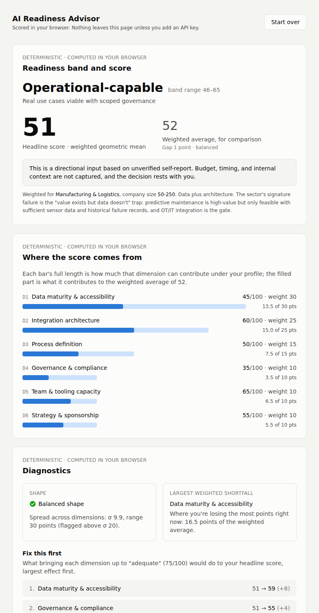
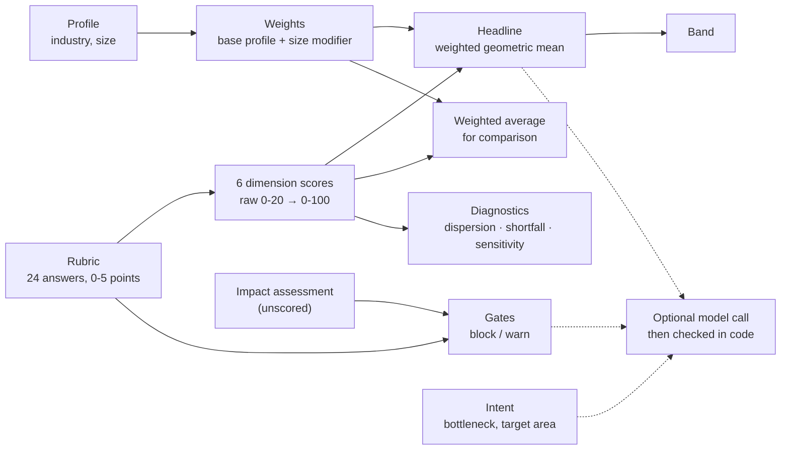

# AI Readiness Advisor

A single-session AI-readiness assessment. 24 concrete questions produce a deterministic,
auditable score; hard gates flag what a company should not attempt yet; an optional model
call (bring your own Anthropic key) suggests use cases, which are checked in code before they
are shown.

**The part that produces the assessment has no runtime dependency on an LLM.** The score,
breakdown, diagnostics and gates are computed in the browser from the answers alone, and the
full report renders with the network disconnected. That is tested, not asserted
(`e2e/offline_report.py`).

**Live demo:** not deployed yet. See [Deploy](#deploy).



## What this is not

This is a transparent, reproducible heuristic built on a reasoned rubric. It is **not a
validated measure** of AI readiness: its point values and weights are the author's judgment,
checked only against three authored personas, never against companies with known outcomes. It
is not a benchmark ("62" is not a percentile). It does not perform a privacy or AI impact
assessment and does not determine anyone's legal obligations; where the law may apply, it
narrows and flags. It does not tell you whether to adopt AI.

## How a score is built



Inputs fall into three scored-or-shaping categories, plus one unscored fact, kept apart in the
types and the code:

| Inputs | What they do | Where they go |
| --- | --- | --- |
| **Profile** (industry, company size) | Select how answers are weighted and which gates apply. Earn no points. | `computeReadiness` |
| **Rubric** (24 answers, 6 dimensions) | The only things scored. | `computeReadiness` |
| **Governance fact** (has an impact assessment been done?) | Unscored. Feeds gate G-U5 and check C6 only. | `computeReadiness` |
| **Intent** (bottleneck, target area, notes, horizon) | Never touch the score. | The recommendation prompt only |

```
src/data     Stage 1  the methodology as typed data: questions, weights, size modifiers, gates, bands
src/engine   Stage 2  pure scoring functions; no DOM, no fetch (enforced by tsconfig.core.json)
src/intake   Stage 3  the wizard; produces ReadinessInput with zero transformation
src/report   Stage 4  the deterministic report, rendered from ScoringOutput alone
src/model    Stage 5  prompt, JSON Schema, API client, validator, gate check, computed summary, fallback
```

## Methods

Every calculation, the question it answers, and why this method. Notation: `d_i` is dimension
*i*'s score (0-100), `w_i` its weight (the six sum to 100). Code: `src/engine/scores.ts`.

| Calculation | What it answers | Method, and why |
| --- | --- | --- |
| **Normalization** | How complete is each dimension? | Four questions per dimension, each worth 0-5 points, so a raw 0-20; `d_i = raw / 20 × 100`. Every dimension has the same maximum (asserted in tests), so no dimension is favored by having more or bigger questions. |
| **Weight resolution** | How much does each dimension matter for *this* company? | `w_i = base_i(industry) + modifier_i(size)`. Five base profiles, each summing to 100; four size bands whose modifiers sum to 0, so every combination still sums to 100 with no negative weight (all 20 checked in tests). Small companies shift weight to people and sponsorship (one departure can end an initiative); large ones to integration and governance (complexity). The weights are judgment; see [Sources](#sources-evidence-and-judgment). |
| **Headline (geometric)** | How ready is the company, when a strong area cannot make up for a missing one? | `S_geom = Π max(d_i, 1)^(w_i/100)`, the weighted geometric mean, rounded to a whole number. Readiness is non-compensatory: excellent data does not rescue a process with no owner. A geometric mean punishes a weak dimension far more than an average does. |
| **The floor of 1** | What happens at 0? | Each `d_i` is floored at 1 before taking logs. This is a deliberate calibration setting, not a divide-by-zero guard. At 1, `ln(d) = 0`, so a missing capability adds nothing rather than subtracting from the others; any other floor either lets "nothing" subtract or treats it as "something". The price is a cliff near zero (one answer can move the headline a band), so the report names every dimension at 0 and says the headline is floor-dominated. |
| **Weighted average and gap** | How much are strong dimensions masking weak ones? | `S_arith = Σ w_i × d_i / 100`, shown beside the headline. The gap `S_arith − S_geom` is clamped at 0 and banded: balanced [0, 5), moderate [5, 15], severe (15, ∞). The imbalance note appears from a gap of 5, the band boundary. |
| **Contribution** | Where does the weighted average come from? | `w_i × d_i / 100` points per dimension, summing to the weighted average. Drawn as bars whose full length is the dimension's weight. |
| **Dispersion** | Is the company's shape lopsided, whatever the weights? | Population σ and range of the six unweighted scores; flagged above σ 20. Unweighted on purpose: this describes the company, not the profile. |
| **Largest weighted shortfall** | Where is the company losing the most points right now? | `argmax w_i × (100 − d_i) / 100`. Ties go to the heavier weight, then D-order. Descriptive only. |
| **Marginal sensitivity ("Fix this first")** | Which single improvement would lift the headline most? | For each dimension below 75, recompute the headline with it raised to 75 ("adequate") and rank by the gain Δ. Dimensions at or above 75 have Δ = 0. It can disagree with the largest shortfall, on purpose: the geometric headline rewards lifting the weakest link, even a lightly weighted one. When every Δ is 2 points or less, the report says no dimension is a clear priority, since the order then comes down to rounding. |
| **Cross-profile range** | How much do the weights (our estimates) matter for this company? | The headline under all five industry profiles, size held fixed. For balanced companies the spread is narrow (the calibration personas vary by 2-5 points at their size band); it widens for lopsided ones. This is a finding, not a defect: the weights matter most where a company is uneven. |
| **Gates** | What should this company not attempt yet, regardless of score? | 15 boolean rules on answers (plus industry and, for G-U5, the impact-assessment fact), independent of the score. *Block* removes a kind of use case; *warn* narrows it. Every gate shows what would clear it. Thresholds are tuned to prefer a false block over a false pass. |
| **Consistency checks** | Do the answers contradict each other? | Six checks (C1-C6), such as claiming governance readiness with no written policy (C2) or on sensitive data with no completed impact assessment (C6). They flag low confidence; they never change the score. |
| **Bands** | What does the number mean in words? | Foundational 0-25, Developing 26-45, Operational-capable 46-65, Scaling-capable 66-80, Mature 81-100, assigned from the rounded headline so the number and label never disagree. A self-report instrument does not support point precision, so the band leads and the number is secondary. |

### What the model does, and what code checks

The optional recommendation call gets the scoring output, the problem statement, and the
constraints it needs to honor them: active gates with their effect text, the category
vocabulary, the six dimensions' names, the dimension to fix first, and (when the back-office
nudge applies) the pre-written alternative. Nothing else about the company.

- The reply is constrained to a JSON Schema at the API (`output_config.format`), then
  validated again in code. The validator checks what a schema cannot: the number of use cases,
  that the pilot is one of them, that the prerequisite names the fix-first dimension, and that
  every dimension id in visible text is followed by its exact name. One repair attempt is
  allowed; what was wrong is shown on the page, collapsed.
- Every suggestion's categories are shown and checked against the gates. A blocked suggestion
  is removed and listed with what would unblock it.
- A pilot that depends on the dimension to fix first is flagged, not removed.
- The score narrative is **computed from the scoring output**, not written by the model, and
  labeled as such. The model is told not to restate numbers; its narrative fields are never
  rendered.

## Sources: evidence and judgment

Listing sources without this distinction would imply the weights and point values come from
them. They don't.

| Design choice | Basis | Evidence or judgment |
| --- | --- | --- |
| The six dimensions | Synthesis of public AI-adoption frameworks and capability models | Evidence-informed synthesis |
| Industry weights and size modifier | Reasoning about what kills AI initiatives in each sector | **Judgment** |
| Question point values | Reasoned; checked only against the three authored personas | **Judgment** |
| Geometric headline and its floor | Non-compensatory composite-index practice; floor chosen for `ln(1) = 0` | Method choice |
| Q5.4: buying and partnering score 5, in-house only 2 | [MIT NANDA, *The GenAI Divide: State of AI in Business 2025*](https://mlq.ai/media/quarterly_decks/v0.1_State_of_AI_in_Business_2025_Report.pdf), p. 19: "Strategic Partnerships (Buy)" (procure external tools, co-develop with vendors) 66% successful deployment; "Internal Development (Build)" 33%; hybrid "insufficient data to quantify". Sample of 52 organizations; the report states the correlation "does not necessarily prove causation" | Evidence (correlational), plus judgment for the exact points |
| Back-office nudge | Same report, p. 9: executives asked to allocate a *hypothetical* $100 of GenAI budget gave about 70% to sales and marketing, because spend "is not yet formally quantified". Pp. 20-21: "some of the most dramatic cost savings" came from back-office automation, e.g. "$2-10M annually in customer service and document processing" from BPO elimination | Evidence, with limits: the allocation is a survey exercise, not measured spend, and the savings are documented cases, not averages |
| D4 questions and the impact-assessment question | PIA/DPIA practice ([GDPR Art. 35](https://gdpr-info.eu/art-35-gdpr/)); [ISO/IEC 42005:2025](https://www.iso.org/standard/42005), AI system impact assessment (published May 2025); [California CCPA regulations](https://cppa.ca.gov/regulations/) on risk assessments, effective Jan 1, 2026 | Evidence-informed |
| Financial gates G-F1, G-F2 | Model risk management guidance: SR 11-7, [superseded on Apr 17, 2026 by SR 26-2](https://www.federalreserve.gov/supervisionreg/srletters/SR2602.htm) (Fed, OCC, FDIC). SR 26-2 says it is "most relevant to banking organizations with over $30 billion in total assets", larger than this tool's typical user | Evidence-informed for the principle; **judgment** in applying it to small institutions |
| Mature-band caution | [ServiceNow Enterprise AI Maturity Index 2025](https://www.servicenow.com/workflow/ai/enterprise-ai-maturity-index-2025.html) (Oxford Economics, ~4,500 executives): "Fewer than 1% of respondents scored higher than 50 on our 100-point scale" | Context only. A different instrument, not a calibration target |
| Calibration targets (weak 25-40, median 40-60, strong 65-80) | Authored | **Judgment** |

## Validation status

The arithmetic is verified by 139 unit tests (every calculation, every boundary, hand-computed
outputs). Whether the score measures readiness is not. Three authored personas land in their
target ranges at the 50-250 anchor: weak **26**, median **51**, strong **77**. They were written
to land there, so this shows the point values behave sensibly, not that they are right.
Evidence that would count: known-outcome organizations scoring in the expected order, two
respondents at one company agreeing, independently written personas, and a practitioner's
review of the rubric.

## Run it

```bash
npm install          # on a fresh clone; if node_modules came from another OS, delete it first
npm run dev          # local dev server
npm test             # 139 unit tests: invariants, engine, calibration, Stage 5
npm run typecheck    # whole app + the browser-free core
npm run build        # typecheck + static build into dist/
```

Browser tests (Python Playwright), against a build served locally:

```bash
npm run build && python -m http.server 8765 --directory dist
python e2e/offline_report.py         http://localhost:8765/index.html e2e/screenshots   # 68 checks
python e2e/stage5_recommendations.py http://localhost:8765/index.html e2e/screenshots   # 46 checks
```

## Deploy

`.github/workflows/deploy.yml` runs the tests, builds, and publishes `dist/` to GitHub Pages on
every push to `main`. Enable it once under **Settings → Pages → Source: GitHub Actions**. The
build uses relative asset paths, so it also works on Vercel or any static host unchanged.

## Your API key

Recommendations are optional. If you add a key:

- it lives only in the page's memory (React state) and is gone on refresh;
- it is sent only to `api.anthropic.com`, straight from your browser, with no server in between;
- it is never written to storage, cookies, or logs. Tests scan the whole codebase for storage
  and console calls, and allow network access from one file only.

With no key, pre-written examples are one click away. They go through the same gate check as
live suggestions, and their summary and roadmap are computed from your own score.

## Known limitations

1. **Weights and point values are our own estimates**, not derived from an empirical study.
   Mitigated by showing the applied profile, its rationale, and the cross-profile range.
2. **Every input is unverified self-report.** Consistency checks catch internal contradictions,
   not a uniformly optimistic respondent.
3. **The size modifier is shared across industries**, not crossed with them, a deliberate
   simplification.
4. **Gate thresholds are conservative judgment calls**, tuned to prefer false blocks over false
   passes. G-H1 and G-F3 fire on "minimal sensitive data", since the regimes behind them have
   no de minimis threshold; they therefore fire for most healthcare and financial respondents.
5. **No benchmarking.** The score is absolute against the rubric.
6. **Culture and change readiness are excluded**, because they cannot be asked about honestly in
   a self-report form.
7. **The gate check verifies a suggestion's tagged categories, not their meaning.** It cannot
   tell whether the model tagged them correctly, so an under-tagged suggestion can pass. The
   categories are shown on every card so a reader can judge. A keyword check was considered and
   rejected: it would put a fuzzy heuristic inside the one deterministic layer.
8. **The model's recommendations are checked for structure, gates and naming, not for truth.**
   Code confirms that dimensions are named correctly and the pilot and prerequisite follow the
   fix-first rule; it cannot confirm that a suggested use case is a good idea.
9. **The impact-assessment question is a flag, not an assessment.** It does not determine
   whether one is legally required.
10. **Single-session, no persistence**, so no re-assessment over time.

This tool encodes a defensible methodology and makes its reasoning visible. It does not replace
an assessment engagement.
