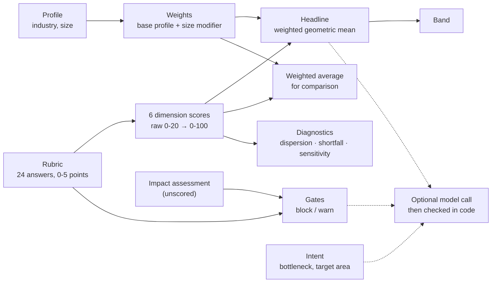

# AI Readiness Advisor

A free self-assessment that scores whether a company's foundations are ready for AI, shows
exactly how the score was built, and flags what not to attempt yet.

## Contents

1. [Overview](#overview)
2. [Why it exists](#why-it-exists)
3. [How to use it](#how-to-use-it)
4. [How a score is built](#how-a-score-is-built)
5. [Methods](#methods)
6. [What the model does, and what code checks](#what-the-model-does-and-what-code-checks)
7. [Sources: evidence and judgment](#sources-evidence-and-judgment)
8. [Validation status](#validation-status)
9. [Privacy and your API key](#privacy-and-your-api-key)
10. [Disclaimer and what this is not](#disclaimer-and-what-this-is-not)
11. [Known limitations](#known-limitations)
12. [Development](#development)
13. [License](#license)

## Overview

Twenty-four concrete questions about how a company works today produce a deterministic,
auditable score across six dimensions: data, integration, process, governance, team and
sponsorship. Hard gates flag the kinds of AI work a company should not attempt yet, each with
what would clear it. An optional model call, with your own Anthropic API key, suggests use cases
against that assessment, and every suggestion is checked in code before it is shown. The report
downloads as a PDF.

**The assessment has no runtime dependency on an LLM.** The score, breakdown, diagnostics and
gates are computed in the browser from the answers alone, and the full report renders with the
network disconnected. That is tested, not asserted (`e2e/offline_report.py`).

**Live site:** [akermaliev.github.io/ai-readiness-advisor](https://akermaliev.github.io/ai-readiness-advisor/)

## Why it exists

Many companies are adopting AI because everyone else is, without a plan for where it fits or
what has to be true first. This tool asks about the foundations before any use case gets picked.

The clearest recent evidence of what happens otherwise is MIT NANDA's 2025 study,
*The GenAI Divide: State of AI in Business 2025* ([PDF](https://mlq.ai/media/quarterly_decks/v0.1_State_of_AI_in_Business_2025_Report.pdf);
copy hosted by a third party, see [Sources](#sources-evidence-and-judgment)). It reports that
"95% of organizations are getting zero return" on their generative AI investment (p. 3). Read it
with its limits:

- **What "success" means there:** tools that "users or executives have remarked as causing a
  marked and sustained productivity and/or P&L impact" (p. 6). Success is self-reported.
- **Sample:** 52 organizations interviewed, 153 senior leaders surveyed, and 300 publicly
  disclosed AI initiatives analyzed, January to June 2025 (p. 2).
- **Correlational:** the report says its build-versus-buy correlation "does not necessarily
  prove causation" (p. 19), and the same caution applies to its other findings.

## How to use it

1. **Who should answer:** one person who knows the process you want to improve. The questions
   are about current practice, not plans.
2. **Time:** about 10 minutes for 24 questions, plus one unscored question about impact
   assessments, then a short screen on what you want from AI (it never affects the score).
3. **Read the report:** the band and headline score, where the score comes from, what to fix
   first, the gates (what not to attempt yet, and what would clear each one), and how much the
   industry weighting matters for your answers.
4. **Optional recommendations:** paste your own Anthropic API key to get use cases tailored to
   your answers, or use the pre-written examples with no key. Use a dedicated key with a spending
   limit; usage is billed to your Anthropic account. The result leads with a three-step roadmap:
   the gap to close first, with the specific answer changes that would close it (computed, no
   model involved); the pilot, with how to tell it worked and when to stop; and what waits, with
   the answers it waits on. The use cases follow as the detail.
5. **Download the PDF:** optionally add a company name for the title and file name.

## How a score is built



Inputs fall into three scored-or-shaping categories, plus one unscored fact, kept apart in the
types and the code:

| Inputs | What they do | Where they go |
| --- | --- | --- |
| **Profile** (industry, company size) | Select how answers are weighted and which gates apply. Earn no points. | `computeReadiness` |
| **Rubric** (24 answers, 6 dimensions) | The only things scored. | `computeReadiness`; the selected labels also go to the optional model call |
| **Governance fact** (has an impact assessment been done?) | Unscored. Feeds gate G-U5 and check C6 only. | `computeReadiness`; also the model call |
| **Intent** (bottleneck, target area, notes, horizon) | Never touch the score. | The recommendation prompt only |

## Methods

Every calculation, the question it answers, and why this method. Notation: `d_i` is dimension
*i*'s score (0-100), `w_i` its weight (the six sum to 100). Code: `src/engine/scores.ts`.

| Calculation | What it answers | Method, and why |
| --- | --- | --- |
| **Normalization** | How complete is each dimension? | Four questions per dimension, each worth 0-5 points, so a raw 0-20; `d_i = raw / 20 × 100`. Every dimension has the same maximum (asserted in tests), so no dimension is favored by having more or bigger questions. |
| **Weight resolution** | How much does each dimension matter for *this* company? | `w_i = base_i(industry) + modifier_i(size)`. Five base profiles, each summing to 100; four size bands whose modifiers sum to 0, so every combination still sums to 100 with no negative weight (all 20 checked in tests). Small companies shift weight to people and sponsorship (one departure can end an initiative); large ones to integration and governance (complexity). The weights are judgment; see [Sources](#sources-evidence-and-judgment). |
| **Headline (geometric)** | How ready is the company, when a strong area cannot make up for a missing one? | `S_geom = Π max(d_i, 1)^(w_i/100)`, the weighted geometric mean, rounded to a whole number. Readiness is non-compensatory: excellent data does not rescue a process with no owner. A geometric mean punishes a weak dimension far more than an average does. |
| **The floor of 1** | What happens at 0? | Each `d_i` is floored at 1 before taking logs. This is a deliberate calibration setting, not a divide-by-zero guard. At 1, `ln(d) = 0`, so a missing capability adds nothing rather than subtracting from the others; any other floor either lets "nothing" subtract or treats it as "something". The price is a cliff near zero (one answer can move the headline a band), so the report names every dimension at 0 and says the headline is floor-dominated. |
| **Weighted average and gap** | How much are strong dimensions masking weak ones? | `S_arith = Σ w_i × d_i / 100`, shown beside the headline. The gap `S_arith − S_geom` is clamped at 0 and banded: balanced [0, 5), moderate [5, 15], severe (15, ∞). The imbalance note appears from a gap of 5, the band boundary. |
| **Contribution** | Where does the weighted average come from? | `w_i × d_i / 100` points per dimension, summing to the weighted average. Drawn as bars whose full length is the dimension's weight. |
| **Dispersion** | Is the company's shape lopsided, whatever the weights? | Population σ and range of the six unweighted scores; flagged above σ 20. Unweighted on purpose: this describes the company, not the profile. |
| **Largest weighted shortfall** | Where is the company losing the most points right now? | `argmax w_i × (100 − d_i) / 100`. Ties go to the heavier weight, then D-order. Descriptive only. |
| **Marginal sensitivity ("Fix this first")** | Which single improvement would lift the headline most? | For each dimension below 75, recompute the headline with it raised to 75 ("adequate") and rank by the gain Δ. Dimensions at or above 75 have Δ = 0. It can disagree with the largest shortfall, on purpose: the geometric headline rewards lifting the weakest link, even a lightly weighted one. When every Δ is 2 points or less, the report says no dimension is a clear priority, since the order then comes down to rounding. |
| **Cross-profile range** | How much do the weights (our estimates) matter for this company? | The headline under all five industry profiles, size held fixed. For balanced companies the spread is narrow (the calibration personas vary by 2-5 points at their size band); it widens for lopsided ones. This is a finding, not a defect: the weights matter most where a company is uneven. |
| **Gates** | What should this company not attempt yet, regardless of score? | 15 boolean rules on answers (plus industry and, for G-U5, the impact-assessment fact), independent of the score. *Block* removes a kind of use case; *warn* narrows it. Every gate shows what would clear it. Thresholds are tuned to prefer a false block over a false pass. |
| **Consistency checks** | Do the answers contradict each other? | Six checks (C1-C6), such as claiming governance readiness with no written policy (C2) or on sensitive data with no completed impact assessment (C6). They flag low confidence; they never change the score. |
| **Bands** | What does the number mean in words? | Foundational 0-25, Developing 26-45, Operational-capable 46-65, Scaling-capable 66-80, Mature 81-100, assigned from the rounded headline so the number and label never disagree. A self-report instrument does not support point precision, so the band leads and the number is secondary. |

## What the model does, and what code checks

**What the model receives:**
- the scoring output
- the selected option label for every question, grouped by dimension, with answers at the top
  option marked, plus the unscored impact-assessment answer
- the problem statement
- the constraints it needs to honor them: active gates with their effect text, the ten gate
  categories with a definition and a "does not count" example each, the six dimensions' names,
  the dimension to fix first, and (when the back-office nudge applies) the pre-written
  alternative

The score is never computed by the model, and raw answer points are not sent.

**What it is told:**
- Every use case must be an AI-assisted workflow. Data, integration and process remediation
  belongs in the prerequisite, never in the use cases, and neither does anything a fixed rule or
  threshold could do.
- A use case that needs another use case must be deferred with it.
- The prerequisite names the fix-first dimension and cites the company's real low answers. A
  top-option answer is never presented as a gap. When every fix-first move is worth 2 points or
  less, the report says no dimension is a clear priority, and the model is told the same: the
  prerequisite becomes optional and nothing is called the weak link.
- The pilot carries a success measure and a stop condition, plus a one-sentence note when it is
  not the use case that most directly serves the stated goal. Each deferral names the questions
  whose answers must improve first.
- Dimensions are referred to only by id plus exact name.
- Numbers from the assessment are never restated.

**How it is called:**
- The reply is constrained to a JSON Schema at the API (`output_config.format`), with up to
  16,000 output tokens.
- The model picker offers Claude Sonnet 5.5 (default), Opus 5.5 and Haiku 5.5. All three get
  adaptive thinking at medium effort
  ([structured outputs](https://platform.claude.com/docs/en/build-with-claude/structured-outputs),
  [adaptive thinking](https://platform.claude.com/docs/en/build-with-claude/adaptive-thinking),
  [effort](https://platform.claude.com/docs/en/build-with-claude/effort)).
- A reply that is cut off, or that carries no text, is retried once at low effort (the same
  request would likely run out again) and then falls back to the pre-written examples.

**What code checks:**
- **Checks a schema cannot express:**
  - the number of use cases
  - that the pilot is one of them (ignoring case, quotes and trailing punctuation)
  - that the prerequisite names the fix-first dimension (or, on a flat ranking, is empty or names
    a dimension below adequate)
  - that every question a deferral waits on is answered below its top option
  - that every dimension id in visible text carries its exact name
  - One retry is allowed; what was wrong is shown on the page, collapsed.
- **Gates:** every suggestion's categories are shown and checked against the gates. A blocked
  suggestion, or a blocked back-office alternative, is removed and listed with what would
  unblock it.
- **Pilot flag:** a pilot that depends on the dimension to fix first is flagged, not removed.
- **The prerequisite's answer changes:** computed by the engine, not the model. Starting from the
  company's answers, it raises that dimension's answers one option at a time until the dimension
  reaches adequate (75), recomputing the whole assessment after each change, and lists the
  resulting dimension score, headline and any gate that stops firing. It is one route, not the
  only one.
- **Score narrative:** computed from the scoring output, not written by the model, and labeled
  as such.
- **Run details panel:** shows each reply's stop reason, token counts and time, and nothing
  else.

## Sources: evidence and judgment

Listing sources without this distinction would imply the weights and point values come from
them. They don't.

| Design choice | Basis | Evidence or judgment |
| --- | --- | --- |
| The six dimensions | The author's synthesis of the areas covered by [Google Cloud's AI Adoption Framework](https://cloud.google.com/resources/cloud-ai-adoption-framework-whitepaper) and [Microsoft's Cloud Adoption Framework for AI](https://learn.microsoft.com/en-us/azure/cloud-adoption-framework/scenarios/ai/) | Evidence-informed synthesis; the split into these six is judgment |
| Industry weights and size modifier | Reasoning about what kills AI initiatives in each sector | **Judgment** |
| Question point values | Reasoned; checked only against the three authored personas | **Judgment** |
| Geometric headline and its floor | Geometric aggregation limits compensability between components; the standard reference is the OECD/JRC [*Handbook on Constructing Composite Indicators*](https://www.oecd.org/en/publications/handbook-on-constructing-composite-indicators-methodology-and-user-guide_9789264043466-en.html) (2008). The floor is chosen for `ln(1) = 0` | Method choice |
| Q5.4: buying and partnering score 5, in-house only 2 | MIT NANDA, *The GenAI Divide* ([PDF](https://mlq.ai/media/quarterly_decks/v0.1_State_of_AI_in_Business_2025_Report.pdf)), p. 19: "Strategic Partnerships (Buy)" (procure external tools, co-develop with vendors) 66% successful deployment; "Internal Development (Build)" 33%; hybrid "insufficient data to quantify". The report states the correlation "does not necessarily prove causation" | Evidence (correlational), plus judgment for the exact points |
| Back-office nudge | Same report, p. 9: executives asked to allocate a *hypothetical* $100 of GenAI budget gave about 70% to sales and marketing, because spend "is not yet formally quantified". Pp. 20-21: "some of the most dramatic cost savings" came from back-office automation, e.g. "$2-10M annually in customer service and document processing" from BPO elimination | Evidence, with limits: the allocation is a survey exercise, not measured spend, and the savings are documented cases, not averages |
| D4 questions and the impact-assessment question | PIA/DPIA practice: [GDPR Art. 35](https://eur-lex.europa.eu/eli/reg/2016/679/oj) (data protection impact assessment); [ISO/IEC 29134:2023](https://www.iso.org/standard/86012.html) (guidelines for privacy impact assessment); [ISO/IEC 42005:2025](https://www.iso.org/standard/42005) (AI system impact assessment); [California CCPA regulations](https://cppa.ca.gov/regulations/) on risk assessments and automated decisionmaking, adopted September 2025 | Evidence-informed |
| Financial gates G-F1, G-F2 | Model risk management guidance: [SR 11-7](https://www.federalreserve.gov/supervisionreg/srletters/sr1107.htm) (2011), [superseded on Apr 17, 2026 by SR 26-2](https://www.federalreserve.gov/supervisionreg/srletters/SR2602.htm) (Fed, OCC, FDIC). SR 26-2 says it is "most relevant to banking organizations with over $30 billion in total assets", larger than this tool's typical user | Evidence-informed for the principle; **judgment** in applying it to small institutions |
| Mature-band caution | [ServiceNow Enterprise AI Maturity Index 2025](https://www.servicenow.com/workflow/ai/enterprise-ai-maturity-index-2025.html) (Oxford Economics, about 4,500 executives): "Fewer than 1% of respondents scored higher than 50 on our 100-point scale" | Context only. A different instrument, not a calibration target |
| Calibration targets (weak 25-40, median 40-60, strong 65-80) | Authored | **Judgment** |

**About the MIT NANDA link.** No copy hosted by MIT was found, so the report is linked through a
third-party copy. The research is from MIT Media Lab's Project NANDA
([nanda.media.mit.edu](https://nanda.media.mit.edu/)); authors Aditya Challapally, Chris Pease,
Ramesh Raskar and Pradyumna Chari.

**Link check, 2026-09-29 and 2026-09-30.** Each URL was fetched with a web page fetcher, which confirms the
page loaded but does not report the raw HTTP status.
- **Loaded:**
  - the MIT NANDA PDF copy
  - Google Cloud's AI Adoption Framework page
  - the OECD handbook page
  - ISO/IEC 29134:2023 and ISO/IEC 42005:2025
  - the CPPA regulations page
  - SR 26-2
  - ServiceNow's 2025 index
  - the three Anthropic docs pages
- **Not yet checked** (the fetch needed an approval that did not arrive):
  - Microsoft's Cloud Adoption Framework for AI
  - SR 11-7
  - the EUR-Lex GDPR text
  - the NANDA project page

## Validation status

The arithmetic is verified by 184 unit tests (every calculation, every boundary, hand-computed
outputs). Whether the score measures readiness is not.

Three authored personas land in their target ranges at the 50-250 anchor: weak **26**, median
**51**, strong **77**. They were written to land there, so this shows the point values behave
sensibly, not that they are right. Moving any single answer one option level changes their
headline by at most 4 points.

The recommendation layer is tested against mocked API replies (57 browser checks: valid,
malformed, gate-violating, cut-off and failed calls). Real calls to the API succeeded on v1.1
and v1.2; the v1.3 reply format (roadmap fields) has so far been exercised only against mocks.
If a live reply does not fit the format, the app retries once and then shows the pre-written
examples, so a failure degrades rather than breaks.

Evidence that would count:
- organizations with known outcomes scoring in the expected order
- two respondents at one company agreeing
- independently written personas
- a practitioner's review of the rubric

## Privacy and your API key

**Everything runs in your browser.**
- The site sets no cookies, uses no browser storage, and loads no analytics, trackers or
  third-party scripts. A Content Security Policy (`security-policy.ts`) lets the page connect
  only to its own origin and `api.anthropic.com`.
- Your answers, the report and the PDF stay in the page's memory and are gone on refresh.

**If you add a key:**
- It lives only in the page's memory (React state) and is gone on refresh.
- It is sent only to `api.anthropic.com`, straight from your browser, with no server in between.
- It is never written to storage, cookies, logs or the PDF. Tests scan the whole codebase for
  storage and console calls, allow network access from one file only, and check the key is
  absent from a generated PDF.

With no key, pre-written examples are one click away. They go through the same gate check as
live suggestions, and their summary and roadmap are computed from your own score.

## Disclaimer and what this is not

This is a directional input based on unverified self-report. Budget, timing, and internal
context are not captured, and the decision rests with you. It is not professional, legal or
compliance advice.

This is a transparent, reproducible heuristic built on a reasoned rubric. It is **not a
validated measure** of AI readiness: its point values and weights are the author's judgment,
checked only against three authored personas, never against companies with known outcomes.

- It is not a benchmark ("62" is not a percentile).
- It does not perform a privacy or AI impact assessment and does not determine anyone's legal
  obligations; where the law may apply, it narrows and flags.
- It does not tell you whether to adopt AI.

## Known limitations

1. **Weights and point values are our own estimates**, not derived from an empirical study.
   Mitigated by showing the applied profile, its rationale, and the cross-profile range.
2. **Every input is unverified self-report.** Consistency checks catch internal contradictions,
   not a uniformly optimistic respondent.
3. **The size modifier is shared across industries**, not crossed with them, a deliberate
   simplification.
4. **Gate thresholds are conservative judgment calls**, tuned to prefer false blocks over false
   passes. G-H1 and G-F3 fire on "minimal sensitive data", since the regimes behind them have
   no de minimis threshold; they therefore fire for most healthcare and financial respondents.
5. **No benchmarking.** The score is absolute against the rubric.
6. **Culture and change readiness are excluded**, because they cannot be asked about honestly in
   a self-report form.
7. **The gate check verifies a suggestion's tagged categories, not their meaning.** It cannot
   tell whether the model tagged them correctly, so an under-tagged suggestion can pass. The
   categories are shown on every card so a reader can judge. A keyword check was considered and
   rejected: it would put a fuzzy heuristic inside the one deterministic layer.
8. **The model's recommendations are checked for structure, gates and naming, not for truth.**
   Code confirms that dimensions are named correctly and the pilot and prerequisite follow the
   fix-first rule; it cannot confirm that a suggested use case is a good idea, or that a
   `dependsOnDimension` is labeled honestly.
9. **The impact-assessment question is a flag, not an assessment.** It does not determine
   whether one is legally required.
10. **The pre-written examples are thin for heavily gated companies.** For some answer patterns
    every example for the industry is gated, so the no-key fallback has no usable pilot.
11. **Single-session, no persistence**, so no re-assessment over time.
12. **The PDF's built-in font covers Latin script only.** A company name, or model text, in
    another script (Cyrillic, CJK) prints as "?". The page warns when a company name is affected.

This tool encodes a defensible methodology and makes its reasoning visible. It does not replace
an assessment engagement.

## Development

**Stack:** React 19, Vite 8, Tailwind 4, TypeScript 7 (strict), Vitest 5, and jsPDF (loaded only
when a PDF is requested).

```bash
npm install          # on a fresh clone; if node_modules came from another OS, delete it first
npm run dev          # local dev server
npm test             # 184 unit tests: invariants, engine, calibration, model layer, PDF, site
npm run typecheck    # whole app + the browser-free core
npm run build        # typecheck + static build into dist/
```

Browser tests (Python Playwright; `site.py` also needs `pypdf` and Node 22.6 or later):

```bash
npm run build && python -m http.server 8765 --directory dist
python e2e/offline_report.py         http://localhost:8765/index.html e2e/screenshots   # 68 checks
python e2e/stage5_recommendations.py http://localhost:8765/index.html e2e/screenshots   # 57 checks
python e2e/site.py dist e2e/screenshots                                                 # 54 checks, served with the production security headers
```

**Deploy.** The site is static: `npm run build`, then publish `dist/`. It is hosted on GitHub
Pages: `.github/workflows/deploy.yml` runs the unit tests and the build on every push to `main`,
then publishes `dist/`.

- **Security headers:** GitHub Pages cannot set custom headers, so the production build carries
  the Content Security Policy as a `<meta>` tag (script, style and connection sources limited to
  the site itself and `api.anthropic.com`). What a meta tag cannot do: `frame-ancestors`
  (clickjacking protection), `X-Content-Type-Options` and `Permissions-Policy`. A host that sets
  headers can use the values in `security-policy.ts` (`_headers` for Cloudflare Pages or Netlify,
  `vercel.json` for Vercel).
- **Link previews:** the workflow builds with `SITE_URL` set, so the preview card gets an
  absolute image URL.

**Project structure:**

```
src/data         the methodology as typed data: questions, weights, size modifiers, gates, bands
src/engine       pure scoring functions; no DOM, no fetch (enforced by tsconfig.core.json)
src/intake       the wizard; produces ReadinessInput with zero transformation
src/report       the deterministic report, rendered from ScoringOutput alone
src/model        prompt, JSON Schema, API client, validator, gate check, computed summary, fallback
src/pdf          the PDF report (jsPDF, lazy-loaded) and the Save panel
src/landing      landing page, Terms and Privacy views (#terms, #privacy), footer
src/site.ts      version, contact and launch settings
security-policy.ts   CSP and security headers, defined once
public/          favicon and link-preview card
e2e/             browser tests
```

## License

[MIT](LICENSE). The Terms and Privacy text shown in the app was written by the author.
